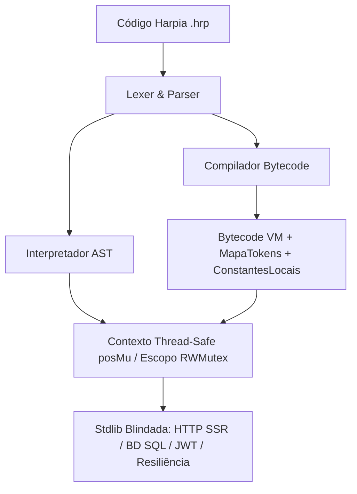

<!--
================================================================================
LOG DE MANUTENÇÃO DE DOCUMENTAÇÃO
--------------------------------------------------------------------------------
Data       | Autor          | Descrição
--------------------------------------------------------------------------------
2026-11-04 | Matheus Diniz  | Criação da ADR 0001 para paridade AST/VM, concorrência e Zero-Trust.
================================================================================
-->

# ADR 0001: Paridade Semântica AST/VM, Concorrência Thread-Safe e Blindagem Zero-Trust na Stdlib

## Status
**Implementada** (2026-11-04)

## Contexto
A auditoria técnica geral do ecossistema Harpia (compilador, interpretador AST, Bytecode VM, biblioteca padrão `stdlib`, CLI e runtime web reativo) identificou divergências de comportamento entre a execução via AST (`hrp.Interpretador`) e a Bytecode VM (`vm.VM`), condições de corrida sob execução concorrente (`go test -race`) e superfícies críticas de segurança em módulos de rede, autenticação e banco de dados.

### Riscos Identificados e Problemas a Resolver
1. **Divergência Semântica AST ↔ Bytecode VM**: A VM permitia reatribuição de variáveis declaradas com `const`, não recuperava `panic` nativo do Go em `OP_CHAMAR` dentro de blocos `tente/capture`, avaliava múltiplas vezes expressões de índice em atribuições compostas (`a[f()] += 1`) e omitia coordenadas (`Token`, `Linha`, `Coluna`, `Arquivo`, `Codigo`) em diagnósticos de `NomeErro` (`PSC-0005`).
2. **Condições de Corrida (Data Races)**: Acessos concorrentes a `Escopo`, aos metadados de posição em `Contexto` (`ArquivoAtual`, `CodigoAtual`, `TokenAtual`, `LinhaAtual`, `ColunaAtual`) e à variável global `hrp.Importe` causavam falhas sob `-race` em canais CSP, servidor HTTP e `Harpia stressar`.
3. **Superfícies de Segurança Zero-Trust**:
   - Aceitação indevida de `alg: "none"` e ausência de validação estrita de JSON no módulo `stdlib/autenticacao` (JWT).
   - Vulnerabilidade a *sibling-directory path traversal* e XSS em `stdlib/http/ssr.go`.
   - Concatenação de nomes de tabelas/colunas e `ORDER BY` sem validação estrita de identificadores SQL em `stdlib/bd/sql.go`.
4. **Resiliência Distribuída (`Disjuntor`)**: No estado `MEIO_ABERTO`, uma falha não reabria imediatamente o disjuntor e múltiplas sondas concorrentes podiam atravessar a barreira simultaneamente.

## 1. Fundamentação Jurídica & Fontes Normativas Diretas
- **OWASP Top 10 (A01 Broken Access Control, A02 Cryptographic Failures, A03 Injection)**: Prevenção de Path Traversal, bypass de assinatura JWT e SQL Injection.
- **RFC 7519 (JSON Web Token)**: Rejeição estrita de algoritmos não autenticados (`none`) e verificação de integridade de cabeçalho e payload.
- **Guias Normativos Internos**: `guia-seguranca-defensiva-zero-trust.md` e `guia-padroes-resiliencia-defensiva.md`.

## 2. Decisão de Arquitetura
Adotamos a unificação de invariantes de execução, sincronização de estado compartilhado e validação Zero-Trust nas fronteiras da biblioteca padrão:

## 3. Matriz de Implementação Técnica (*IN-CODE*)
- **Core & VM (`hrp/`, `vm/`)**:
  - Rastreamento de constantes em `EscopoCompilador` (`SimboloLocal.Constante`) e `ConstantesLocais` no `Frame` da VM, bloqueando reatribuição em tempo de compilação e em `OP_ARMAZENAR_LOCAL`/`OP_ARMAZENAR_GLOBAL`.
  - Mapeamento `MapaTokens map[int]*lexer.Token` por IP de bytecode para reconstrução exata de pilha de erro e sugestões Levenshtein (`PSC-0005`).
  - Proteção de `OP_CHAMAR` com `recover()` convertendo panics nativos do Go em `*hrp.Erro` (`RuntimeErro`) capturáveis por `tente/capture`.
  - Sincronização de `Escopo` via `sync.RWMutex`, proteção de coordenadas em `Contexto` via `posMu` e inicialização estática de `hrp.Importe` delegando a `ObterContextoAtivo()`.
- **Stdlib & Segurança (`stdlib/`)**:
  - `stdlib/bd/sql.go`: Validação estrita de identificadores SQL (`validarIdentificadorSQL`) e clonagem imutável do `QueryBuilder`.
  - `stdlib/autenticacao/autenticacao.go`: Validação de `alg == "HS256"` com `hmac.Equal` em tempo constante e `json.Valid` no payload.
  - `stdlib/http/ssr.go`: Verificação de fronteira de diretório com separador de caminho e serialização segura via `json.Marshal`.
  - `stdlib/resiliencia/resiliencia.go`: Sonda atômica única (`sondaEmCurso`) em `MEIO_ABERTO` e retorno imediato para `ABERTO` em caso de falha.

## 4. Matriz de Ações de Governança & Jurídicas (*OFF-CODE*)
- Execução obrigatória de `go test -short -race ./...` e `go vet ./...` na pipeline de CI (`.github/workflows/ci.yml`).

## 5. Prazos Legais de Guarda e Políticas de Retenção
- Não aplicável diretamente ao runtime da linguagem (sem retenção de dados pessoais pelo compilador).

## 6. Matriz de Conformidade e Mitigação de Riscos
| Risco | Mitigação Implementada | Verificação |
| :--- | :--- | :--- |
| Bypass de autenticação JWT (`alg: none`) | Verificação explícita do header `alg: HS256` e `hmac.Equal` | `TestJWT_RejeitarAlgNone` |
| SQL Injection em colunas/tabelas | Regex/validador de identificadores antes de interpolar SQL | `TestQueryBuilderBloqueiaSQLInjectionEmColunas` |
| Path Traversal e XSS no SSR | Checagem de prefixo com `filepath.Separator` + `json.Marshal` | `TestServirAppSiblingTraversalEXSS` |
| Data races em execução concorrente | `sync.RWMutex` em `Escopo` e `posMu` em `Contexto` | `go test -short -race ./...` |

## 7. Consequências e Resultados
### Positivas
- Paridade comportamental determinística entre o interpretador AST e a Bytecode VM (`--vm`).
- Eliminação completa de condições de corrida em cargas concorrentes (`Harpia stressar`, canais CSP e servidor HTTP).
- Blindagem nativa contra SQLi, XSS, Path Traversal e tokens forjados.

### Mitigações e Desafios Gerenciados
- Pequeno overhead de sincronização (`RWMutex`) em leituras/escritas de `Escopo` e `Contexto`, amplamente compensado pela segurança de memória em goroutines.
