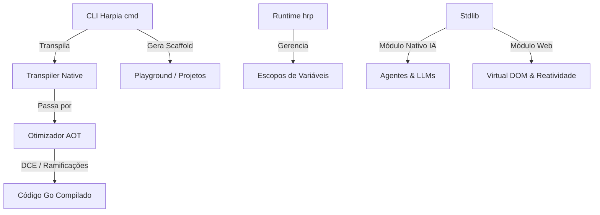

# 📝 Registro de Desenvolvimento — 17 de Julho de 2026

**Escopo:** Consolidação do ecossistema Harpia, compilador nativo com Otimizador AOT, suporte a IA/Agentes e melhorias Web/Playground
**Commits gerados:** 8
**Arquivos modificados:** 20

---

## 1. Visão Geral das Alterações

Esta sessão de desenvolvimento consolidou o ecossistema do Harpia após o rebranding. Foi implementado um novo **Otimizador Estático AOT** com eliminação de código morto (DCE), o módulo nativo de **IA/Agentes** baseado em contratos abstratos, e melhorias substanciais no **Virtual DOM reativo** e no playground interativo. Também corrigimos todas as suites de testes afetadas por extensões e códigos de erro legados.

---

## 2. Arquitetura Afetada

Diagrama de blocos mostrando os componentes modificados no ecossistema Harpia:

---

## 3. Mapa de Arquivos Modificados

| Arquivo                     | Tipo       | O que mudou                                                                           |
| --------------------------- | ---------- | ------------------------------------------------------------------------------------- |
| `cmd/otimizador.go`         | Compilador | Novo mecanismo de Dead Code Elimination (DCE) e simplificação de branches constantes. |
| `cmd/transpiler_native.go`  | Compilador | Integração do Otimizador AOT antes da compilação física do código Go.                 |
| `stdlib/ia/ia.go`           | Biblioteca | Módulo de Inteligência Artificial nativa com suporte a chamada de LLMs.               |
| `stdlib/ia/contratos.go`    | Biblioteca | Abstrações estruturadas para agentes autônomos de IA cooperativos.                    |
| `stdlib/web/runtime-web.js` | Web        | Motor de Virtual DOM reativo atualizado com melhorias no ciclo de reatividade.        |
| `playground/playground.go`  | Web        | Lógica de retaguarda de execução e visualização do playground.                        |

---

## 4. Detalhamento por Commit

### `fix(tests): corrige caminhos e codigos de erro nos testes apos rebranding`

**Razão da alteração:**

> Garantir que as ferramentas de CI/CD e de validação local de testes unitários passem com sucesso após as mudanças de extensões de arquivo e códigos de erro.

**O que faz agora:**

> Os testes de scaffolding e do linter LSP agora validam corretamente as extensões `.hrp` e os códigos de erro rotulados com o prefixo `HRP-0005`.

---

### `feat(otimizador): adiciona otimizador estatico AOT para o compilador nativo`

**Razão da alteração:**

> Reduzir o overhead em binários gerados pela compilação AOT (Go Nativo) eliminando variáveis e ramificações que nunca serão utilizadas ou alcançadas.

**O que faz agora:**

> Remove símbolos sem referências (Dead Code Elimination) e otimiza ifs cujas expressões condicionais se resolvem como constantes conhecidas em tempo de compilação.

---

### `feat(ia): implementa modulo nativo de IA com contratos abstratos e agentes`

**Razão da alteração:**

> Oferecer capacidades modernas de inteligência artificial de forma nativa e integrada à sintaxe Harpia, ideal para construir fluxos assistidos e agentes autônomos de decisão em Português.

**O que faz agora:**

> Expõe funções nativas de IA, gerência contratos semânticos e comunicação estruturada multi-agente.

---

## 5. ✅ O Que Está Funcionando

- Scaffolding completo de monolitos, backends e frontends com extensões `.hrp`
- Otimização AOT por eliminação de código morto (DCE) e redução de ifs de condição constante
- Execução de diagnósticos de segurança e erros no linter LSP com nomenclatura `HRP`
- Fluxo de execução multi-agente mockado no ambiente de testes da Stdlib/IA

---

## 6. ❌ O Que Está Pendente

- `[ ]` Integração com APIs reais de provedores (Anthropic/OpenAI) no pacote `stdlib/ia` — _aguardando definições de chaves e de tokens de faturamento_.

---

## 7. ⚠️ Dívida Técnica Identificada

- **Lógica de importação duplicada**: A stdlib estendida e a stdlib nativa possuem pequeno acoplamento na declaração inicial do arquivo `stdlib/stdlib.go`.
- **Suporte restrito no Otimizador**: Atualmente, o otimizador foca apenas em tipos básicos (como `Inteiro` e constantes diretas). Poderá estender para expressões mais complexas no futuro.

---

## 8. Padrões Importantes a Lembrar

- Sempre que adicionar um módulo nativo na `stdlib`, lembre-se de registrá-lo em `stdlib/stdlib.go` e definir suas declarações de tipo.
- Mensagens de erro semântico reportadas pelo compilador ou pelo LSP devem sempre seguir a nomenclatura unificada `HRP-XXXX`.

---

## 9. Próximos Passos

1. Estabelecer o conector HTTP físico com Provedores na stdlib de IA.
2. Expandir as regras de otimização estática para dobragem de constantes matemáticas (Constant Folding).

---

## 10. Validações Mapeadas

| Campo / Função     | Regra de validação                              | Status |
| ------------------ | ----------------------------------------------- | ------ |
| Scaffolding `.hrp` | Geração física de arquivos com nova extensão    | ✅     |
| Otimizador AOT     | Teste automatizado de DCE e ramos constantes    | ✅     |
| Linter LSP         | Diagnósticos gerados em JSON com formato Harpia | ✅     |
| Agentes IA         | Validação de troca de mensagens e contratos     | ✅     |
