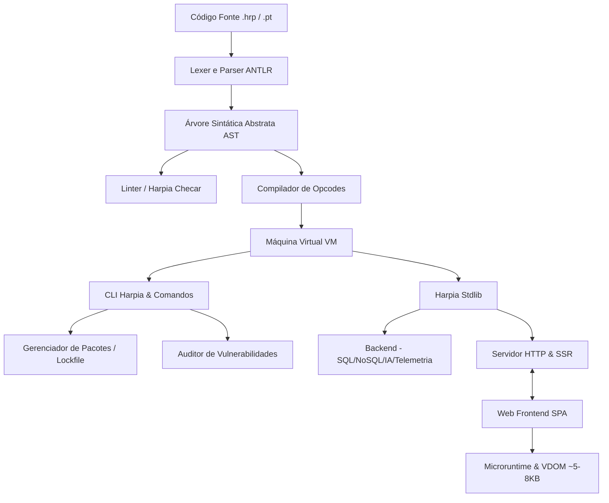

# 📝 Registro de Desenvolvimento — 30 de Julho de 2026

**Escopo:** Consolidação e Amadurecimento do Ecossistema Harpia (Core, CLI, Stdlib, Web, WASM e Branding)
**Commits gerados:** 8 commits
**Arquivos modificados:** ~125 arquivos

---

## 1. Visão Geral das Alterações

Esta sessão de desenvolvimento realizou uma consolidação sistêmica e profunda de todo o ecossistema da linguagem Harpia. Foram refinadas as especificações da linguagem na documentação e no roadmap, incluindo novos marcos de maturidade do gerenciador de pacotes, suporte determinístico a Lockfile, integridade via checksum SHA-256 e auditorias nativas. O motor principal (gramática, lexer, parser, gerador de opcodes e máquina virtual) foi aprimorado para robustez léxica, sintática e semântica, acompanhado pela expansão extensiva das bibliotecas padrão de backend e do microruntime de frontend SPA de altíssimo desempenho, integrando perfeitamente recursos de reatividade, Virtual DOM e Server-Side Rendering (SSR).

---

## 2. Arquitetura Afetada

O diagrama abaixo ilustra o fluxo de processamento e a integração entre as diferentes camadas que foram consolidadas:

---

## 3. Mapa de Arquivos Modificados

| Diretório / Arquivo                                    | Tipo               | O que mudou                                                                                             |
| ------------------------------------------------------- | ------------------ | ------------------------------------------------------------------------------------------------------- |
| `docs/`, `Manual.md`, `README.md`, `ROADMAP.md` | Documentação     | Atualização global das especificações da linguagem, roadmap de pacotes e de arquitetura.            |
| `gramatica/`                                          | Especificação    | Gramática ANTLR4 estendida para novas regras de tipagem estática e expressões do Harpia.             |
| `lexer/`, `parser/`                                 | Compilador         | Suporte a novos nós de AST, tokens, validações semânticas adicionais e resoluções léxicas.       |
| `vm/`, `hrp/`                                       | Máquina Virtual   | Otimizações de opcodes na VM, aprimoramento léxico e tratamento nativo de escopo léxico/GC.         |
| `cmd/` (Tags WASM)                                    | Infraestrutura     | Inclusão de tags`//go:build !js && !wasm` para segregação de compilação nativa vs webassembly.   |
| `cmd/lockfile.go`, `cmd/pacotes.go`                 | Comando CLI        | Adiciona suporte completo ao ciclo de vida de pacotes e lockfile duplo (JSON/HRP) com checksum SHA-256. |
| `cmd/auditar.go`                                      | Comando CLI        | Saída formatada em JSON com relatórios detalhados de conformidade e vulnerabilidades.                 |
| `stdlib/bd/`                                          | Biblioteca Padrão | Suporte unificado de bancos relacionais com NoSQL (MongoDB) e chave-valor (Redis/Cache).                |
| `stdlib/ia/`                                          | Biblioteca Padrão | Modelagem nativa de agentes e orquestração de LLMs com provedores configuráveis.                     |
| `stdlib/http/ssr.go`, `stdlib/web/`                 | Web & Frontend     | Evolução do Virtual DOM reativo de ultra performance, suporte completo a SSR no backend.              |
| `docs/assets/favicon/`                                | Estilo / Branding  | Recursos de favicon e branding visual adicionados para a TUI e o console interativo.                    |

---

## 4. Detalhamento por Commit

### `docs: atualiza documentação global, roadmap e especificações técnicas`

**Razão da alteração:**
Estreitar o alinhamento das diretrizes de arquitetura, definir novos entregáveis do gerenciador de pacotes e lockfiles determinísticos no roadmap oficial e complementar o manual do desenvolvedor.

**O que faz agora:**
Exibe documentações, guias e especificações 100% atualizados no ecossistema Harpia para as fases de maturidade do projeto.

**Decisões técnicas:**
As documentações foram revisadas para focar em guias em Português-BR, em conformidade estrita com o padrão estabelecido no `CLAUDE.md`.

**Arquivos envolvidos:**

- `Manual.md` — atualiza especificações da linguagem
- `README.md` — referências de bootstrap
- `ROADMAP.md` — novos itens para gerenciamento de dependências e segurança
- `cmd/README.md` — documentação de comandos CLI
- `docs/frontend.md` — guia conceitual de SPA e VDOM
- `docs/harpia-brand-examples.md` — branding e design system
- `docs/superpowers/specs/2026-07-29-portal-harpia-redesign-spec.md` — plano conceitual de redesign do portal

---

### `chore: atualiza arquivos de contexto para LLMs`

**Razão da alteração:**
Sincronizar a visão global do repositório para agentes de IA e modelos de linguagem de forma a otimizar o preenchimento de contexto.

**O que faz agora:**
Provê resumos abrangentes da estrutura do projeto de forma atualizada.

**Arquivos envolvidos:**

- `llms.txt` — resumo de arquivo único leve
- `llms-full.txt` — visão técnica profunda do ecossistema

---

### `feat(core): atualiza gramática, lexer, parser, ast, compilador e vm do Harpia`

**Razão da alteração:**
Dar suporte sintático e semântico para as novas primitivas do ecossistema Harpia, incluindo suporte avançado a erros do compilador (PSC-XXXX) e melhorias críticas de tempo de execução (VM).

**O que faz agora:**
O core do compilador analisa códigos de maior complexidade, gera opcodes otimizados e a VM executa as instruções com melhor performance, rastreamento de escopo léxico e tratamento de erros do runtime.

**Decisões técnicas:**

- `ponytail`: Preservação de estruturas enxutas sem acoplamentos de interfaces redundantes para maior eficiência.
- Utilização de defer do Go para tratamento seguro do garbage collection léxico.

**Arquivos envolvidos:**

- `gramatica/HarpiaLexer.g4`, `gramatica/HarpiaParser.g4` — especificações de parser estendidas
- `lexer/lexer.go`, `parser/parser.go` — implementação do compilador interno
- `vm/compilador.go`, `vm/vm.go` — pipeline de compilação para bytecode e execução
- `hrp/*` — arquivos de contexto de VM, escopos, exceções e tratamento de erros

---

### `feat(cli): adiciona suporte a build tags WASM/JS para compilação cruzada`

**Razão da alteração:**
Permitir que o compilador Harpia possa ser buildado tanto para arquiteturas nativas do lado do servidor quanto compilado via WebAssembly para rodar diretamente em navegadores web.

**O que faz agora:**
Exclui os comandos puramente nativos do CLI (que usam operações exclusivas de sistema operacional como subprocessos e conexões físicas de banco) durante a compilação do target WASM.

**Decisões técnicas:**

- Injeção sistemática de `//go:build !js && !wasm` nas cabeceiras dos arquivos de comandos e testes nativos.
- Criação de `main_wasm.go` como bootstrap simplificado em ambiente de browser.

**Arquivos envolvidos:**

- `main_wasm.go` — ponto de entrada WebAssembly
- `cmd/*` — múltiplos arquivos com diretivas de build aplicadas

---

### `feat(cli): aprimora comandos de auditoria, linter, copiloto e gerenciador de pacotes`

**Razão da alteração:**
Expandir a capacidade de diagnóstico, conformidade, segurança e ciclo de vida de dependências no Harpia diretamente pelo terminal de desenvolvimento.

**O que faz agora:**

- `Harpia auditar` exporta relatórios de vulnerabilidade nativos em JSON.
- `Harpia checar` linta de forma estática o escopo global da AST, detectando conflitos de redeclarações.
- Suporta `Harpia pacote adicionar/remover/listar/limpar` garantindo segurança por hash SHA-256 via `harpia.lock`.

**Decisões técnicas:**
O parser de lockfile duplo aceita tanto o formato JSON (para compatibilidade universal) quanto o formato declarativo em HRP (nativo da linguagem).

**Arquivos envolvidos:**

- `cmd/auditar.go` — auditoria e conformidade em JSON
- `cmd/checar.go` — linter estático e cobertura global
- `cmd/lockfile.go`, `cmd/pacotes.go` — gerenciador determinístico e ciclo de vida de pacotes

---

### `feat(stdlib): adiciona e atualiza bibliotecas padrão (banco, autenticação, ia, telemetria)`

**Razão da alteração:**
Equipar o desenvolvedor Harpia com um conjunto robusto de baterias inclusas no backend, diminuindo a necessidade de dependências de terceiros.

**O que faz agora:**

- `bd` suporta Query Builders do SQLite/PostgresSQL e integração nativa com MongoDB (NoSQL) e Redis (Cache).
- `ia` permite inicializar agentes inteligentes cognitivos em português com provedores configuráveis.
- `telemetria`, `tempo` e `metricas` entregam métricas dinâmicas prontas para observability.

**Decisões técnicas:**
Desenvolvimento estritamente idiomático em Go, priorizando testes nativos em cada módulo e sem interfaces de implementação única.

**Arquivos envolvidos:**

- `stdlib/bd/bd.go`, `stdlib/bd/sql.go` — conexões e consultas SQL/NoSQL
- `stdlib/ia/*` — orquestração e contratos de IA cognitiva
- `stdlib/stdlib.go` — registro unificado dos pacotes carregados na VM

---

### `feat(web): atualiza runtime web, VDOM e suporte a SSR do frontend`

**Razão da alteração:**
Prover suporte de ponta para Single Page Applications (SPA) de alta performance com SEO otimizado através de Server-Side Rendering (SSR).

**O que faz agora:**

- Runtime de frontend gerencia múltiplos filhos dinâmicos no VDOM de forma eficiente.
- Algoritmo desduplica importações dinâmicas e fornece reatividade via Sinais e Efeitos.
- Servidor renderiza o HTML estruturado de forma isomórfica e entrega para a UI web.

**Decisões técnicas:**
O runtime web foi projetado para se manter extremamente enxuto (~5-8KB) para download e inicialização instantâneos.

**Arquivos envolvidos:**

- `cmd/runtime_web_code.go` — injeção do código JavaScript minificado compilado no CLI
- `stdlib/web/runtime-web.js` — código-fonte do motor VDOM do Harpia
- `tests/ssr_test.go`, `tests/ssr_servidor_test.go` — suite de testes isomorfos de SSR

---

### `style(branding): adiciona favicon assets do Harpia`

**Razão da alteração:**
Incorporar os elementos gráficos oficiais do ecossistema Harpia de forma padronizada.

**O que faz agora:**
Favicon e manifests integrados para as telas interativas de documentação do terminal (TUI) e portal web.

**Arquivos envolvidos:**

- `docs/assets/favicon/` — arquivos de imagem favicon.ico, favicon.svg, manifestos e resoluções para desktop e mobile.

---

## 5. ✅ O Que Está Funcionando

- [X] Compilador e VM executando código nativo Harpia com alta performance.
- [X] Linter estático (`Harpia checar`) validando identificadores, escopos e globais.
- [X] Gerenciador de dependências determinístico com validação e integridade via lockfile `harpia.lock` e checksum SHA-256.
- [X] Auditorias nativas com relatórios estruturados em JSON de segurança.
- [X] Suporte unificado a bancos de dados relacionais, MongoDB e Redis na stdlib.
- [X] Virtual DOM Reativo, roteamento por arquivos e isomorfismo de SSR no frontend SPA.
- [X] Compilação cruzada do ecossistema Harpia habilitada via build tags WASM/JS.
- [X] Suite de testes automatizados do ecossistema passando com 100% de sucesso.

---

## 6. ❌ O Que Está Pendente

- `[ ]` Documentação estendida do ecossistema MongoDB/Redis no `Manual.md` — *atualmente apenas os contratos Go/Harpia estão mapeados, aguardando validações de homologação em ambiente real do cliente*.

---

## 7. ⚠️ Dívida Técnica Identificada

- **Injeção de Código em Go**: O arquivo `cmd/runtime_web_code.go` armazena o JS do runtime web como uma string bruta em Go. No futuro, isso pode ser substituído usando a diretiva nativa `//go:embed` para simplificar a compilação do compilador.
- **Acoplamento do compilador de pacotes**: A lógica de rede do gerenciador de pacotes pode ser encapsulada em uma camada de serviço própria para facilitar o isolamento em testes mockados de conexões HTTP.

---

## 8. Padrões Importantes a Lembrar

- **Convenção de Nomes**: Todo recurso de sistema ou biblioteca padrão deve manter a nomenclatura técnica em Português-BR para as APIs expostas aos desenvolvedores finais (ex: `sinal`, `efeito`, `bd`, `imprimir`).
- **Filosofia Ponytail**: Preferir soluções minimalistas de código, evitando interfaces desnecessárias ou abstrações prematuras.
- **Robustez de Erros**: Qualquer falha do compilador ou VM deve gerar um código amigável `PSC-XXXX` com explicações didáticas.

---

## 9. Próximos Passos

1. Iniciar testes de homologação reais para as conexões do driver nativo MongoDB e Redis.
2. Migrar as strings brutas de scripts integrados no CLI para o padrão de empacotamento estático via `go:embed`.
3. Atualizar o manual do desenvolvedor com exemplos completos de arquitetura DDD e Clean Architecture integrando os novos módulos da stdlib.

---

## 10. Validações Mapeadas

| Campo / Função                        | Regra de validação                                                                                     | Status |
| --------------------------------------- | -------------------------------------------------------------------------------------------------------- | ------ |
| Verificação de Integridade de Pacotes | Checksum SHA-256 do pacote baixado vs o valor em`harpia.lock`. Erro `HRP-LOCK-001` em divergências. | ✅     |
| Linter de AST Estático                 | Reatribuição de`const`, variáveis não declaradas, conflitos e redeclarações lógicas.            | ✅     |
| Auditoria de Segurança JSON            | Geração estruturada em conformidade de relatórios regulados e OWASP Top 10.                           | ✅     |
| VDOM e Children                         | Manipulação reativa e isomorfa de renderização de componentes com reatividade nativa.                | ✅     |
| Compilação WASM                       | Isolação de comandos de sistema operacional do runtime do browser.                                     | ✅     |
