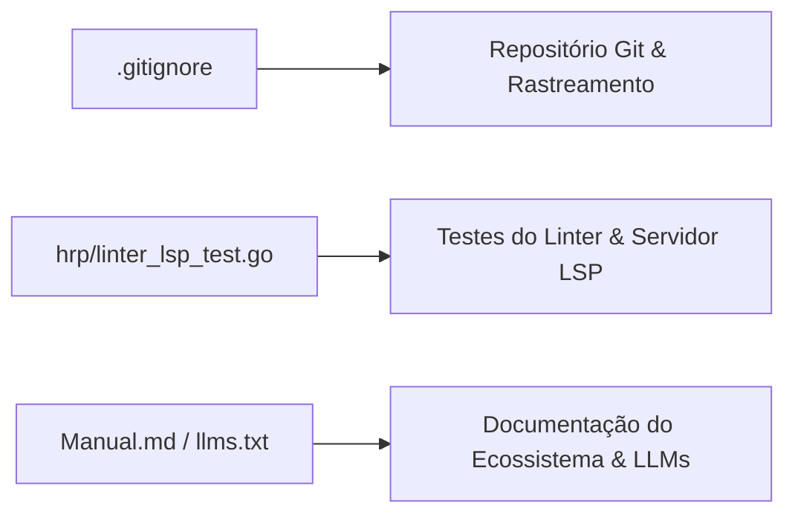

# 📝 Registro de Desenvolvimento — 2026-07-30

**Escopo:** `git-linter-docs` (Reestruturação do .gitignore, Correção de Captura no Linter e Atualização do Manual de Referência)  
**Commits gerados:** 3  
**Arquivos modificados:** 5  

---

## 1. Visão Geral das Alterações

> Nesta sessão, foi realizada a reorganização profissional e sanitização do arquivo `.gitignore`, garantindo a exclusão adequada de executáveis Go, artefatos web, bancos de dados locais, diretórios de testes/projetos e metadados de ferramentas de IA. Também foi corrigida a captura de diagnósticos JSON no teste do linter LSP para evitar contaminação por mensagens de stderr, e foi atualizada e sincronizada toda a base de manuais de referência em Markdown e exports para LLMs.

---

## 2. Arquitetura Afetada

---

## 3. Mapa de Arquivos Modificados

| Arquivo | Tipo | O que mudou |
|--------|------|-------------|
| `.gitignore` | Configuração | Reestruturado e categorizado com seções em PT-BR para ignorar binários, bancos de dados, projetos locais e artefatos de IA |
| `hrp/linter_lsp_test.go` | Test | Ajustado para capturar stdout com `cmdRun.Output()` em vez de `CombinedOutput()` no teste de diagnósticos JSON |
| `Manual.md` | Documentação | Atualizado com a especificação didática e técnica exaustiva do compilador, VM e ferramentas do Harpia |
| `llms-full.txt` | Documentação | Export de contexto completo sincronizado para consumo por agentes de IA e LLMs |
| `llms.txt` | Documentação | Export de resumo executivo sincronizado para suporte a modelos de linguagem |

---

## 4. Detalhamento por Commit

### `chore(git): restrutura .gitignore para ignorar binarios, dados e projetos locais`

**Razão da alteração:**
> Evitar inclusão acidental de binários compilados (`Harpia`, `harpia_dev`, `app-teste`), bancos SQLite locais (`dados.db`), pastas de playgrounds (`projetos/`) e metadados gerados por ferramentas de agentes de IA (`.openclaude`, `.superpowers`, `.remember`).

**O que faz agora:**
> O arquivo `.gitignore` categoriza todas as regras de exclusão em seções organizadas em português e garante que arquivos sensíveis ou gerados não sejam rastreados.

**Decisões técnicas:**
> Mantidas as exceções explícitas como `!.env.example` e refinadas as rotas de ignore para impedir a exclusão da pasta de código-fonte da extensão VS Code (`vscode-harpia/`).

**Arquivos envolvidos:**
- `.gitignore` — reestruturação completa das regras do repositório.

---

### `fix(linter): usa Output em vez de CombinedOutput na captura de JSON do LSP`

**Razão da alteração:**
> No teste `TestLinterLSPDiagnosticsJSON`, o uso de `CombinedOutput()` misturava stdout e stderr. Se o linter emitisse qualquer log na stderr, a tentativa de `json.Unmarshal` falhava com erro de sintaxe JSON.

**O que faz agora:**
> Utiliza `cmdRun.Output()`, garantindo que apenas a saída padrão (stdout) formatada em JSON seja desserializada.

**Decisões técnicas:**
> Separação estrita dos canais de saída durante os testes automatizados da CLI.

**Arquivos envolvidos:**
- `hrp/linter_lsp_test.go` — alteração da chamada de captura do comando `checar --formato=json`.

---

### `docs(manual): atualiza manual de referencia oficial e exports para LLMs`

**Razão da alteração:**
> Manter a documentação oficial da linguagem, arquitetura da VM, stdlib e ecossistema sincronizados e atualizados para desenvolvedores e modelos de linguagem.

**O que faz agora:**
> Atualiza `Manual.md`, `llms-full.txt` e `llms.txt` com as especificações mais recentes.

**Decisões técnicas:**
> Manutenção de múltiplos formatos (`.md` estruturado e `.txt` para contexto de LLMs).

**Arquivos envolvidos:**
- `Manual.md` — manual completo de referência.
- `llms-full.txt` — texto integral para consumo de LLMs.
- `llms.txt` — visão sumarizada do repositório.

---

## 5. ✅ O Que Está Funcionando

- Rastreamento e exclusão do Git sanitizados sem afetar arquivos de código-fonte.
- Testes unitários e de integração de todo o projeto (`go test ./...`) 100% passando.
- Teste de diagnósticos JSON do linter LSP validado e isolado.
- Documentação técnica e manuais completamente sincronizados.

---

## 6. ❌ O Que Está Pendente

- `[ ]` Nenhuma pendência imediata associada aos commits desta sessão.

---

## 7. ⚠️ Dívida Técnica Identificada

- Nenhuma dívida técnica crítica introduzida.

---

## 8. Padrões Importantes a Lembrar

- No Git, usar sempre regras relativas (ex: `/projetos/` ou `projetos/`) e nunca caminhos absolutos locais do sistema de arquivos.
- Ao testar comandos CLI que retornam JSON, preferir `cmd.Output()` a `cmd.CombinedOutput()` para prevenir contaminação do JSON por logs em stderr.

---

## 9. Próximos Passos

1. Continuar o desenvolvimento da Sprint 6 e evolução do ecossistema Harpia.
2. Manter atualizada a documentação em `docs/commits/` em futuras sessões.

---

## 10. Validações Mapeadas

| Campo / Função | Regra de validação | Status |
|---------------|-------------------|--------|
| Regras Gitignore | Exclusão correta de binários, dbs e logs | ✅ |
| Linter LSP JSON | Saída limpa em stdout e desserialização sem erros | ✅ |
| Suíte de Testes | Execução integral de `go test ./...` | ✅ |
