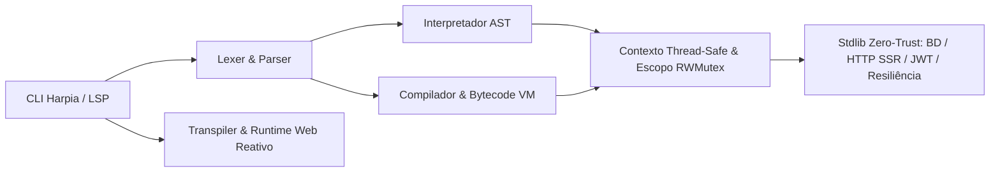

<!--
================================================================================
LOG DE MANUTENÇÃO DE DOCUMENTAÇÃO
--------------------------------------------------------------------------------
Data       | Autor          | Descrição
--------------------------------------------------------------------------------
2026-11-04 | Matheus Diniz  | Registro consolidado da implementação do Plano Master de Auditoria (8 Ondas / 21 Tasks).
================================================================================
-->

# Registro de Desenvolvimento — 2026-11-04

| Metadado | Detalhe |
| :--- | :--- |
| **Escopo Principal** | `auditoria-master-seguranca-vm-stdlib` |
| **Commits Gerados** | `7` |
| **Arquivos Modificados** | `151` |
| **ADRs Vinculadas / Geradas** | `docs/adrs/0001-paridade-vm-concorrencia-e-blindagem-zero-trust.md` |

---

## 1. Visão Geral das Alterações
> Implementação completa e verificada das 8 Ondas (21 Tasks) do Plano Master de Correções da Auditoria Geral do ecossistema Harpia. As entregas estabelecem paridade semântica e diagnóstica 100% determinística entre o Interpretador AST (`hrp`) e a Bytecode VM (`vm`), eliminam todas as condições de corrida sob `go test -race ./...`, blindam os módulos da biblioteca padrão (`stdlib/bd`, `stdlib/http`, `stdlib/autenticacao`, `stdlib/resiliencia`) segundo princípios Zero-Trust e atualizam o CLI, o runtime reativo Web e a extensão VS Code.

---

## 2. Arquitetura Afetada & Decisões (ADRs)
- **Decisões Registradas:**
  - `docs/adrs/0001-paridade-vm-concorrencia-e-blindagem-zero-trust.md`: Unificação de invariantes semânticas entre AST e Bytecode VM (`const` imutável, recuperação de `panic` em `OP_CHAMAR`, mapeamento IP → Token para diagnósticos `PSC-0005`), sincronização concorrente em `Escopo` e `Contexto`, e blindagem Zero-Trust em SQL, SSR, JWT e Circuit Breaker.
- **Diagrama de Relações e Fluxos:**

---

## 3. Mapa de Arquivos Modificados

| Arquivo / Diretório | Camada Técnica | Resumo da Modificação |
| :--- | :--- | :--- |
| `hrp/contexto.go`, `hrp/escopo.go`, `hrp/importe.go` | Core Runtime | Sincronização thread-safe (`posMu`, `sync.RWMutex`) e eliminação de race global em `Importe` |
| `hrp/decimal.go`, `hrp/interpretador.go`, `hrp/erros.go` | Core / AST | Aritmética `Decimal` completa, avaliação única de índice composto, `finalmente` em `retorne` e erros ricos |
| `vm/compilador.go`, `vm/vm.go` | Bytecode VM | Imutabilidade de `const`, `recover()` em `OP_CHAMAR`, `MapaTokens` para erros ricos e limite de recursão |
| `stdlib/bd/sql.go`, `stdlib/http/ssr.go`, `stdlib/autenticacao/autenticacao.go` | Stdlib Zero-Trust | Validação de identificadores SQL, proteção contra Path Traversal/XSS no SSR e rejeição de `alg: none` em JWT |
| `stdlib/resiliencia/resiliencia.go`, `stdlib/matematica/*`, `stdlib/tensor/*` | Stdlib / Resiliência | Sonda atômica única no `Disjuntor` em `MEIO_ABERTO` e validações de domínio/dimensão científica |
| `cmd/*`, `stdlib/web/runtime-web.js` | CLI & Web Runtime | Formatador lexing-aware, sincronização do spinner, proteção de rotas CLI e `sanitizarHtml` / `armazem` seguro |
| `docs/adrs/0001-paridade-vm-concorrencia-e-blindagem-zero-trust.md` | Governança | ADR formalizando as decisões arquiteturais e de segurança da sessão |

---

## 4. Detalhamento por Commit

### `fix(core): garantir paridade semantica, aritmetica decimal e seguranca concorrente`
- **Razão da alteração:** Eliminar data races sob execução concorrente e corrigir lacunas semânticas em `Decimal`, escapes léxicos e atribuições indexadas compostas.
- **Comportamento atual:** `Escopo` e `Contexto` operam sem data races sob `-race`; `Decimal` suporta `-`, `/`, `%`, `//`, `**`; `a[f()] += 1` avalia `f()` uma única vez.
- **Decisões técnicas & ADRs:** Vinculado à ADR 0001.
- **Arquivos envolvidos:** `compartilhado/numeros.go`, `parser/parser.go`, `hrp/*`.

### `fix(vm): assegurar imutabilidade de const, captura de panics e rastreamento de tokens`
- **Razão da alteração:** Garantir paridade total entre a Bytecode VM (`--vm`) e o interpretador AST quando acionada pelos testes e em produção.
- **Comportamento atual:** `const` é estaticamente e dinamicamente imutável na VM; panics nativos do Go em funções embutidas são convertidos em `RuntimeErro` dentro de `tente/capture`; erros `PSC-0005` exibem linha, coluna, trecho sublinhado e sugestão Levenshtein.
- **Decisões técnicas & ADRs:** Vinculado à ADR 0001.
- **Arquivos envolvidos:** `vm/compilador.go`, `vm/vm.go`, `vm/vm_test.go`.

### `fix(stdlib): blindar sql, ssr, jwt, resiliencia e modulos cientificos`
- **Razão da alteração:** Mitigar riscos de SQL Injection, XSS/Path Traversal no SSR, bypass de algoritmo em JWT e corrida em `MEIO_ABERTO` no Circuit Breaker.
- **Comportamento atual:** Identificadores SQL inválidos são bloqueados, `QueryBuilder` é imutável por clonagem, `alg: none` é rejeitado em JWT, SSR valida prefixo com separador de diretório e serializa estado com `json.Marshal`, e `Disjuntor` permite apenas 1 sonda concorrente em `MEIO_ABERTO`.
- **Decisões técnicas & ADRs:** Vinculado à ADR 0001.
- **Arquivos envolvidos:** `stdlib/*`, `tests/stdlib_fase3_test.go`.

### `fix(cli): aprimorar comandos cli, lsp, formatador, transpiler e runtime-web`
- **Razão da alteração:** Alinhar ferramentas de linha de comando, formatador, servidor LSP e runtime web reativo às garantias de segurança e corretude.
- **Comportamento atual:** `Harpia formatar` ignora chaves dentro de strings/comentários, `Harpia crie rota` e `i18n` bloqueiam Path Traversal, `runtime-web.js` protege `armazem` contra colisão com `Object.prototype` e cancela efeitos pendentes na mesma microtask.
- **Decisões técnicas & ADRs:** Vinculado à ADR 0001.
- **Arquivos envolvidos:** `cmd/*`, `playground/playground.go`, `stdlib/web/runtime-web.js`.

### `chore(infra): atualizar extensao vscode, pipelines ci/cd, adr e grafo de conhecimento`
- **Razão da alteração:** Sincronizar artefatos de infraestrutura, extensão VS Code (`v1.2.0`), ADR 0001 e grafo de conhecimento Graphify.
- **Comportamento atual:** Workflows CI/CD operam com menor privilégio e validação contínua; extensão VS Code e grafo atualizados.
- **Decisões técnicas & ADRs:** Registra `docs/adrs/0001-paridade-vm-concorrencia-e-blindagem-zero-trust.md`.
- **Arquivos envolvidos:** `.github/workflows/*`, `vscode-harpia/*`, `docs/adrs/*`, `graphify-out/*`.

### `fix(ci): resolver bloqueio de poll no Linux e alertas CodeQL de conversao inteira e zipslip`
- **Razão da alteração:** Eliminar loop infinito em `unix.Poll` quando `Revents` retorna `POLLHUP`/`POLLERR` sem `POLLIN` em sockets desconectados no Linux e atender às verificações estáticas de limites de 32 bits (`CWE-190`) e sanitização de caminhos (`go/zipslip`) do CodeQL.
- **Comportamento atual:** `RecebeDados` e `AceitaConexao` tratam `POLLHUP`, `POLLERR` e `POLLNVAL` sem bloqueio infinito no Linux; conversões `int64 -> int` validam limites explícitos; extração de arquivos valida prefixo com separador e rejeita `..`.
- **Decisões técnicas & ADRs:** Vinculado à ADR 0001.
- **Arquivos envolvidos:** `stdlib/soquete/impl.go`, `hrp/texto.go`, `hrp/tupla.go`, `stdlib/tempo/tempo.go`, `cmd/atualizar.go`.

---

## 5. Dívida Técnica & Próximos Passos

- [ ] Expandir cobertura de benchmarks comparativos entre o Interpretador AST e a Bytecode VM (`--vm`) para workloads intensivos de matrizes e tensores.
- [ ] Adicionar testes E2E automatizados para o Harpia API Console (`/docs` e `/scalar`) na pipeline de CI.
